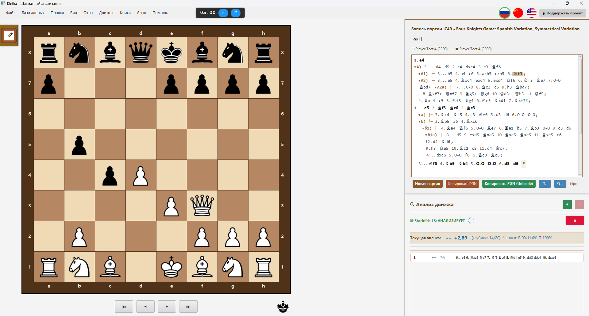
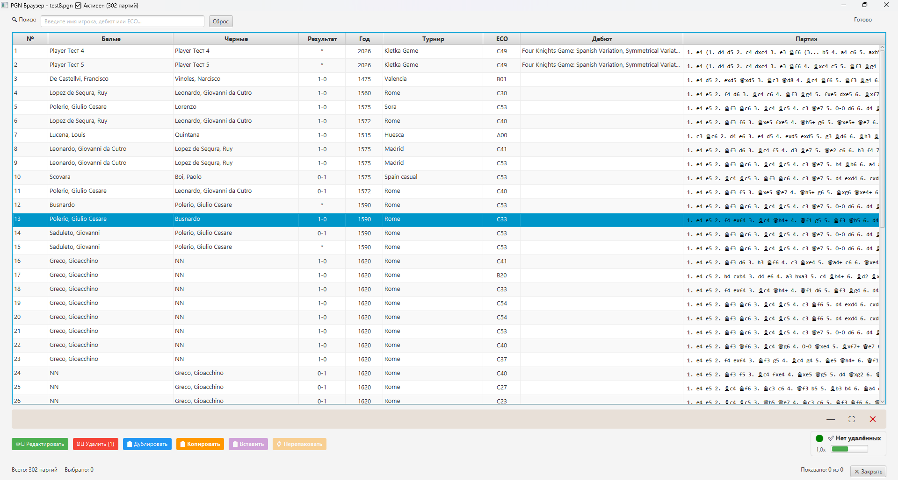
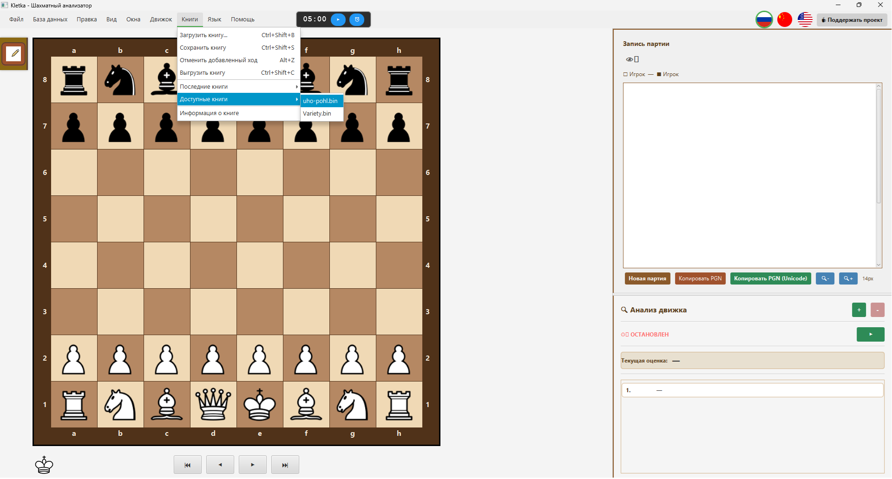
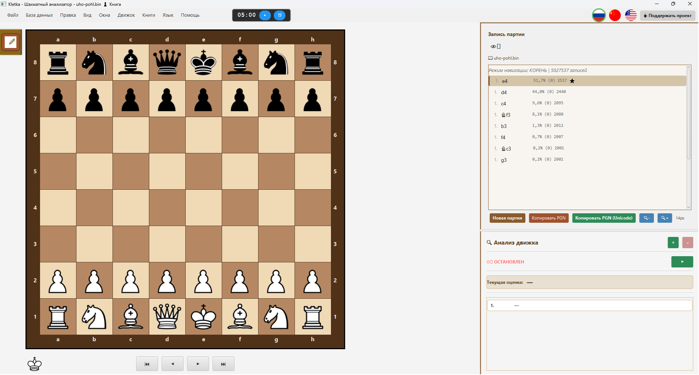

# ♟️ Клетка — Кроссплатформенный шахматный анализатор

[](https://github.com/AndreyKhrypach/Kletka/releases/latest)
[](https://www.gnu.org/licenses/gpl-3.0)
[]()

## 🌐 **Веб сайт:** [https://andreykhrypach.github.io/Kletka/](https://andreykhrypach.github.io/Kletka/)

**Читать на:**
[🇬🇧 English](README.md) |
[🇷🇺 Русский](README.ru.md) |
[🇨🇳 中文](README.zh.md)

---

**Клетка** — это кроссплатформенный шахматный анализатор с поддержкой PGN файлов, вариантов, аннотаций и движка Stockfish. Программа имеет современный настраиваемый интерфейс и доступна для Windows, Linux и macOS.

## 📝 Журнал изменений

Подробную историю изменений смотрите в [CHANGELOG.md](CHANGELOG.md).

---

## 🚀 Возможности

- 📁 Открытие, редактирование и сохранение PGN файлов
- 🧩 Полная поддержка вариантов и аннотаций
- 📚 **Дебютные книги Polyglot** — загрузка, просмотр и **редактирование** дебютных вариантов
- 📤 **Экспорт дерева в Polyglot книгу** — сохранение личного репертуара
- 🏗️ **Создание Polyglot-книги из PGN-файла** — построение статистической книги из тысяч партий
- 🚀 **Мультизагрузка партий в Polyglot-книгу** — выделите партии в PGN-браузере, нажмите Enter — книга создаётся и загружается мгновенно (до 10 000 партий)
- 🧹 **Массовая очистка комментариев в PGN** — потоковая обработка больших файлов (~1 ГБ за ~2.5 минуты) без загрузки в память
- ⚙️ **Динамическое выделение памяти JVM** — приложение автоматически адаптируется к объёму RAM (4/8/16/32 ГБ)
- 🔍 Анализ позиции с **Stockfish** (UCI движок)
- 🎨 Настраиваемые темы доски
- 📋 **Копирование позиции** в формате FEN + ASCII (Ctrl+Shift+P)
- 💾 **Сохранение позиции в PGN** — вырезание позиции из партии в отдельный файл задач (Ctrl+Shift+E)
- 🐛 **Отчёт о проблеме** — встроенная форма обратной связи через GitHub (меню Помощь)
- 📦 **Пакеты для Debian, Ubuntu, Fedora, RHEL, openSUSE** — установка в один клик
- 🌍 Мультиязычность: Русский, English, 中文
- 🖥️ Кроссплатформенность: Windows, Linux, macOS

---

## 📺 Видеоуроки

Пошаговые руководства на нашем YouTube-канале:

**Windows:**
- [Kletka: установка на Windows](https://www.youtube.com/watch?v=OSaSA-Qm0GY)
- [Kletka: настройка Stockfish на Windows](https://www.youtube.com/watch?v=TWhIM4zsmIY)
- [Kletka: как пользоваться Polyglot книгами](https://www.youtube.com/watch?v=QAz95CSiDy0)

**Linux:**
- [Kletka: установка на Linux](https://www.youtube.com/watch?v=NXeR6J0_rXA)
- [Kletka: настройка Stockfish на Linux](https://www.youtube.com/watch?v=m-qWoTGNIXg)

**macOS:**
- [Kletka tutorial: macOS — установка](https://www.youtube.com/watch?v=JBtitIr7mF8)
- [Kletka tutorial: macOS — настройка Stockfish](https://www.youtube.com/watch?v=v29AsFNnBEc)

---

## 💬 Сообщество

- 🇷🇺 [Представляю Клетка — шахматный анализатор (Lichess blog)](https://lichess.org/@/KhrypachAndrey/blog/-/Qz4tM8oE)
- 🇬🇧 [Introducing Kletka — chess analyzer (Lichess blog)](https://lichess.org/@/KhrypachAndrey/blog/introduce-kletka-chess-analyzer/p73trA8b)

---

## 📚 Дебютные книги (Polyglot)

Клетка поддерживает **дебютные книги Polyglot** (файлы `.bin`), что позволяет вам интерактивно изучать шахматные дебюты — и создавать **свой** дебютный репертуар.

### Как использовать дебютные книги:

1. Перейдите в меню **Книги → Загрузить книгу**
2. Выберите файл Polyglot книги (`.bin`)
3. Навигация по вариантам с помощью клавиатуры:
   - **↑ / ↓** — перемещение между вариантами
   - **→ / Enter** — выбор варианта
   - **←** — возврат на предыдущую позицию

### Как редактировать книгу:

Клетка позволяет добавлять ходы прямо в загруженную книгу:

- Сделайте ход на доске — он автоматически добавится в книгу
- Нажмите **Alt+Z** — отменить последний добавленный ход
- **Книги → Сохранить книгу** (Ctrl+Shift+S) — применить изменения в `.bin` файл
- **Книги → Выгрузить книгу** (Ctrl+Shift+C) — выгрузить книгу

### Экспорт дерева в Polyglot книгу:

Вы можете экспортировать текущее дерево анализа в Polyglot книгу:

1. Проанализируйте или расставьте позицию с вариантами
2. Перейдите в **Книги → Экспорт в Polyglot книгу...**
3. Выберите папку и имя файла — книга создаётся в формате `.bin`

Все ходы из дерева (главная линия + все варианты) попадают в книгу. Транспозиции и дубликаты автоматически дедуплицируются.

Полученную книгу можно загрузить обратно в Клетку или использовать в Stockfish, Leela, ChessBase, Scid, Arena и других совместимых программах.

### Создание Polyglot-книги из PGN-файла:

Построение **статистической дебютной книги** из большой базы PGN (например, 900 000 партий):

1. Перейдите в **Книги → Создать книгу из PGN...**
2. Выберите исходный `.pgn` файл и целевой `.bin` файл
3. Программа парсит каждую партию (только главную линию), накапливает статистику побед/поражений/ничьих для каждого хода и записывает Polyglot книгу.

Это отличается от **«Экспорта дерева в Polyglot»** (который создаёт личный репертуар из одной проанализированной партии). Функция создания из PGN строит **статистическую книгу** из тысяч реальных партий. Полученная книга совместима со Stockfish, Leela, ChessBase, Scid и Arena.

### Мультизагрузка партий в Polyglot-книгу:

Быстрый способ построить книгу из выбранных партий без промежуточных диалогов:

1. Откройте PGN-браузер (Ctrl+B)
2. Выделите нужные партии (до 10 000) — мышью с Shift/Ctrl или Ctrl+A для всех
3. Нажмите **Enter**

Под капотом мгновенно создаётся Polyglot-книга во временной папке и тут же загружается в режим **BOOK**. Вы сразу видите все ходы и дебютные варианты — никаких диалогов «Сохранить как», никаких лишних кликов.

При создании книги проверяется **3-кратное повторение**: партия обрезается на моменте ничьей, ходы после неё не включаются.

Если книга уже была загружена и в ней есть несохранённые изменения — появится диалог **Сохранить / Не сохранять / Отмена** (для временной книги запрос показывается всегда).

### Системные требования для книг

Для работы с дебютными книгами Клетка требует:

- **Java 17 LTS** (рекомендуется Liberica Full JDK)
- Аргументы JVM (автоматически применяются при запуске через лаунчер):


```
--add-opens java.base/sun.nio.ch=ALL-UNNAMED
--add-opens java.base/sun.misc=ALL-UNNAMED
```

**Примечание:** Если вы запускаете Клетка из командной строки, используйте:

```bash
java --add-opens java.base/sun.nio.ch=ALL-UNNAMED \
--add-opens java.base/sun.misc=ALL-UNNAMED \
-jar Kletka.jar
```

Эти аргументы необходимы для быстрой работы с Polyglot книгами с использованием файлов, отображаемых в память (mmap).

**Память:** Клетка использует динамическое выделение памяти JVM (`-XX:MaxRAMPercentage=70.0`) и автоматически адаптируется к объёму RAM. При создании Polyglot-книги из больших PGN-файлов может появиться предупреждение о нехватке памяти — оценка выполняется по количеству партий в файле.

### 🔧 Технические детали: Memory-Mapped Files

Клетка использует **memory-mapped files** (`MappedByteBuffer`) для молниеносно быстрой работы с Polyglot книгами, даже на HDD.

**Важно:** Mapped byte buffer **не освобождается** сборщиком мусора JVM, пока на него есть ссылка. Чтобы вы могли **удалить, переместить или заменить** файл книги во время работы Kletka, приложение явно вызывает:

```
sun.misc.Unsafe.invokeCleaner(mappedByteBuffer);
```

Это немедленно снимает блокировку файла на уровне ОС.

**Что это значит для вас:**
- ✅ Можно безопасно **удалять** и **перемещать** `.bin` файл после выгрузки книги
- ✅ Можно **заменять** файл книги на новый
- ✅ Никаких ошибок "файл занят другим процессом" на Windows

### Linux: исправление фокуса на Wayland

На Debian Trixie / Ubuntu 24.04+ / Fedora 41+ с Wayland диалоги могут не получать фокус (клавиатура работает, мышь — нет).
Это известный баг JavaFX + Wayland, отслеживается в [JDK-8353643](https://bugs.openjdk.org/browse/JDK-8353643).

Мы исправили это в Клетке:

- Заменили ListView на VBox с кнопками (виртуализация ListView конфликтует с Wayland).

- Использовали Modality.NONE + setMouseTransparent(true) на корневом узле сцены, чтобы обойти Focus Stealing Prevention в GNOME.

- Убрали зависимость от флага -Djdk.gtk.version=2 (теперь поддерживается чистый GTK 3 + Wayland).

Результат: диалоги теперь работают на Wayland так же, как на Windows/macOS — обходной путь с Tab больше не нужен.

---

### Рекомендуемые книги:

Для наилучших результатов мы рекомендуем использовать книгу **`uho-pohl.bin`**, которая содержит обширные качественные дебютные варианты.

### Где взять Polyglot книги:

Вы можете скачать бесплатные дебютные книги из официального репозитория Polyglot:
🔗 **[Polyglot Books Repository](https://github.com/ChrisWhittington/polyglot-books)**

Другие популярные источники:
- [UHO-Pohl openings](https://www.chessdb.com/) — качественная база дебютов
- [ChessTempo's Polyglot books](https://www.chesstempo.com/)
- Создайте свою собственную книгу в формате Polyglot

---

## ⚡ Производительность

- **Индексация PGN** — 900 000 партий за ~50 секунд (ускорение ×21).
- **Пакетная обработка** — удаление/вставка 100 000 партий заметно быстрее (×2).
- **Загрузка сложных партий** — алгоритм именования вариантов ускорен в 5–6 раз.
- **Массовая очистка комментариев** — потоковая обработка PGN ~1 ГБ (900 000 партий) за ~2.5 минуты без загрузки в память.
- **Динамическая память JVM** — `-XX:MaxRAMPercentage=70.0` вместо фиксированного `-Xmx4g`: приложение адаптируется к объёму RAM (4/8/16/32 ГБ).

---

## 🔄 Автоматическая проверка обновлений

При запуске Kletka делает один HTTPS-запрос к GitHub API для проверки новой версии. Если обновление доступно, в верхнем меню появляется иконка 🔄. Клик открывает страницу релизов.

- Анонимно: отправляется только User-Agent (Kletka-UpdateChecker) и IP-адрес (как при любом HTTPS-запросе).

- Никакие персональные данные не собираются.

- Также можно проверить вручную: Помощь → Проверить обновления.

---

## 📋 Копирование позиции (FEN + ASCII)

Вы можете скопировать текущую позицию в буфер обмена в удобном формате — **FEN** плюс **ASCII-диаграмма**:

- Меню: **Правка → Копировать позицию**
- Горячая клавиша: **Ctrl+Shift+P**

Это удобно для:

- Обмена позициями в чатах, на форумах, в issue-трекерах
- Анализа позиций с ИИ-ассистентами
- Документирования позиций в текстовых файлах

Вывод содержит FEN в первой строке и ASCII-диаграмму ниже, обёрнутую в Markdown-блок кода для удобной вставки.

---

## 🐛 Известные проблемы на macOS

### Drag-and-drop: фигура "хватается за угол"

**Симптомы:**
- Фигура визуально берётся за угол, а не за центр.
- Чтобы сделать ход, мышку нужно вести в угол целевой клетки.
- После drop курсор может исчезнуть, пока мышь не попадёт в меню.

**Причина:**
Известный баг JavaFX **JDK-8333919** — на macOS игнорируются смещения `dragViewOffsetX/Y`.

**Решение:**
Исправлен в **JavaFX 23** (требует **JDK 21+**).
Клетка сейчас использует **Java 17** + **JavaFX 17**.

**Обходной путь:**
- Используйте **click-to-move** (клик на фигуру → клик на клетку) вместо drag-and-drop.
- Или дождитесь миграции Клетки на **JDK 25** + **JavaFX 25** (планируется в будущих релизах).

**Статус:**
Будет исправлено при миграции на JDK 25 + JavaFX 25 (планируется в будущих релизах).

---

## 🖥️ Скриншоты

### Краткий обзор

<table>
  <tr>
    <td></td>
    <td></td>
  </tr>
  <tr>
    <td><em>Главный интерфейс</em></td>
    <td><em>Обозреватель PGN</em></td>
  </tr>
  <tr>
    <td></td>
    <td></td>
  </tr>
  <tr>
    <td><em>Открытие Polyglot книги</em></td>
    <td><em>Загруженная Polyglot книга</em></td>
  </tr>
</table>

---

## 🖥️ Полный размер


---

## 📦 Установка

### Windows
Скачайте `Kletka.exe` со страницы [Releases](https://github.com/AndreyKhrypach/Kletka/releases) и запустите установщик.

### macOS
Скачайте .dmg для вашего процессора со страницы [Releases](https://github.com/AndreyKhrypach/Kletka/releases), откройте его и перетащите `Kletka.app` в папку `Applications`.

- Apple Silicon (M1/M2/M3... MacBook Air/Pro): Kletka-1.8.0-air.dmg

- Intel (x86_64): Kletka-1.8.0-intel.dmg

⚠️ Важно для macOS: Перед установкой новой версии удалите старую «Клетку» из Applications.

### Linux (Debian/Ubuntu)
Скачайте `Kletka.deb` со страницы [Releases](https://github.com/AndreyKhrypach/Kletka/releases)

```bash
sudo dpkg -i kletka*.deb
```

### Linux (Fedora / RHEL / Rocky / Alma / openSUSE)

```bash
sudo dnf install kletka*.rpm
```

---

## 🛠️ Сборка из исходников

### Требования
- **Java 17** (рекомендуется Liberica Full JDK) — скачайте с [BellSoft](https://bell-sw.com/pages/downloads/#/java-17-lts)
- **Maven** — установите через `brew install maven` (macOS) или `sudo apt install maven` (Linux)

### Важные аргументы JVM для разработки

При запуске из IDE добавьте следующие параметры VM:

```
--add-opens java.base/sun.nio.ch=ALL-UNNAMED
--add-opens java.base/sun.misc=ALL-UNNAMED
```

Это обеспечивает полную поддержку Polyglot книг во время разработки.

```bash
git clone https://github.com/AndreyKhrypach/Kletka.git
cd Kletka
mvn clean package
```

### Сборка для конкретной платформы

```bash
# Windows
mvn clean package -P windows

# Linux (Debian)
mvn clean package -P linux-debian

# Linux (Ubuntu)
mvn clean package -P linux-ubuntu

# Linux (Fedora / RHEL / openSUSE)
mvn clean package -P linux-rpm

# macOS
mvn clean package -P mac
```

Примечание для RPM-сборки: на машине сборки должен быть установлен rpm-build:

```bash
sudo dnf install rpm-build
```
---

## 🧠 Настройка Stockfish

Клетка использует движок Stockfish для анализа. Вам нужно установить его отдельно.

### Windows

1. Скачайте Stockfish с официального сайта: https://stockfishchess.org/download/
2. Распакуйте архив
3. В Клетка перейдите в **Движок → Настроить движок** и выберите файл `stockfish.exe`

### Linux (Debian/Ubuntu)

```bash
sudo apt install stockfish
```

Затем в Клетка перейдите в **Движок → Настроить движок** и выберите бинарный файл stockfish.

### Linux (Fedora / RHEL)

```bash
sudo dnf install stockfish
```

Затем в Клетка перейдите в Движок → Настроить движок и выберите бинарный файл stockfish.

### macOS

```bash
brew install stockfish
```

Затем в Клетка перейдите в **Движок → Настроить движок** и выберите бинарный файл stockfish.

---

## 📄 Лицензия

Этот проект распространяется под лицензией GNU General Public License v3.0.
Подробнее см. файл [LICENSE](https://github.com/AndreyKhrypach/Kletka/blob/master/LICENSE).

---

## 👨‍💻 Автор

Andrey Khrypach

---

## ⭐ Поддержка

Если вам нравится проект, поставьте ⭐ на GitHub!